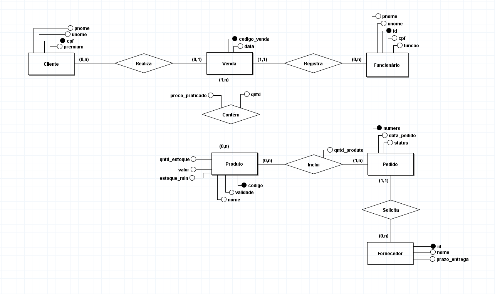

# CafezesBI – Definição do problema e modelagem

## Nome do SBD

**CafezesBI:** sistema para o gerenciamento de estoque

> Desenvolvimento (nomes e matrículas): ver o [README principal](../README.md).

## Sobre o projeto

A CaFezes é uma cafeteria que vende cafés raros, como o Kopi Luwak (produzido a partir de grãos ingeridos e excretados pela civeta), e cafés de temporada. São produtos de **oferta limitada** e, no caso dos sazonais, com **período de venda definido**.

Nesse contexto, o controle de estoque é essencial:

- **Faltar café raro** significa perder uma venda que não dá para repor na hora, porque os lotes dos fornecedores são pequenos.
- **Sobrar café de temporada** no fim do período significa prejuízo.
- **A qualidade cai com o tempo de armazenamento**, então é preciso acompanhar a validade dos itens.
- **O cardápio pode não refletir a disponibilidade real** se o estoque não for atualizado a cada venda.
- **Os pedidos de reposição precisam ser planejados** com base no estoque atual e na demanda histórica.

O sistema controla a quantidade em estoque de cada café, registra as vendas, registra os pedidos de reposição feitos aos fornecedores e avisa quando um café está acabando, para que a reposição seja feita a tempo.

## Requisitos

- Armazenar dados dos produtos, clientes, fornecedores e funcionários.
- Registrar vendas e atualizar o estoque em tempo real.
- Registrar pedidos de produtos aos fornecedores.
- Editar preços de produtos.
- Inserir novo produto, cliente ou funcionário no banco de dados.
- Não permitir repetição de produtos, clientes e funcionários.
- Não permitir venda sem café suficiente em estoque.
- Alertar quando o estoque de um café ficar abaixo do mínimo e sugerir pedido de reposição com base na média de vendas.
- Registrar o funcionário responsável por cada venda.
- Disponibilizar uma tela de consulta SQL.

## Etapas

| Etapa | Conteúdo | Arquivo |
|---|---|---|
| 1 | Definição do problema e requisitos | este arquivo |
| 2 | Diagrama entidade-relacionamento | [`etapa-2-diagrama-er.png`](etapa-2-diagrama-er.png) |
| 3 | Modelo lógico | [`etapa-3-modelo-logico.md`](etapa-3-modelo-logico.md) |

## Diagrama entidade-relacionamento

Desenhado no BrModelo, em notação de Peter Chen, com cardinalidades no formato (mín,máx). No BrModelo, a chave primária é o círculo preenchido.

